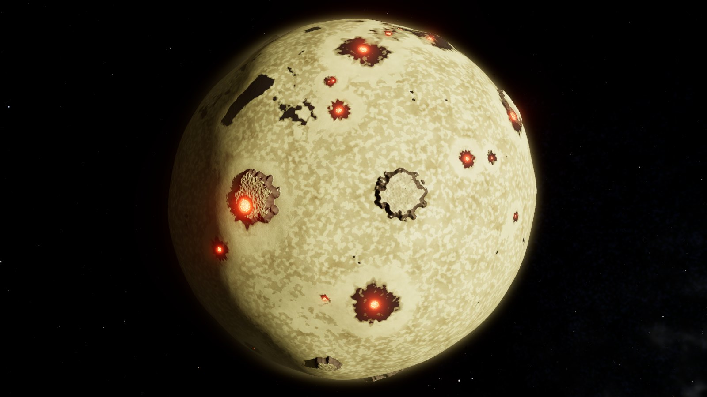
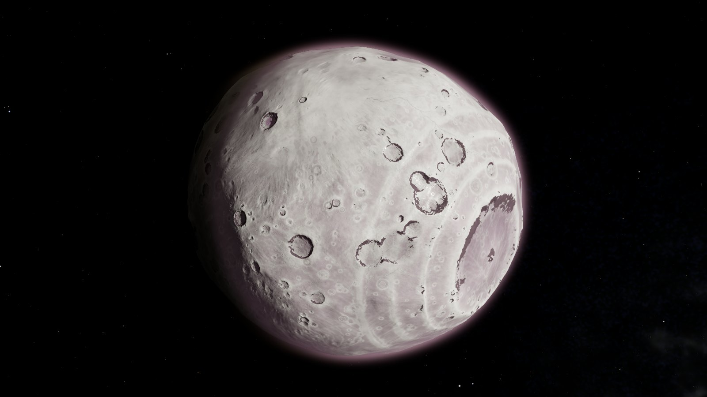
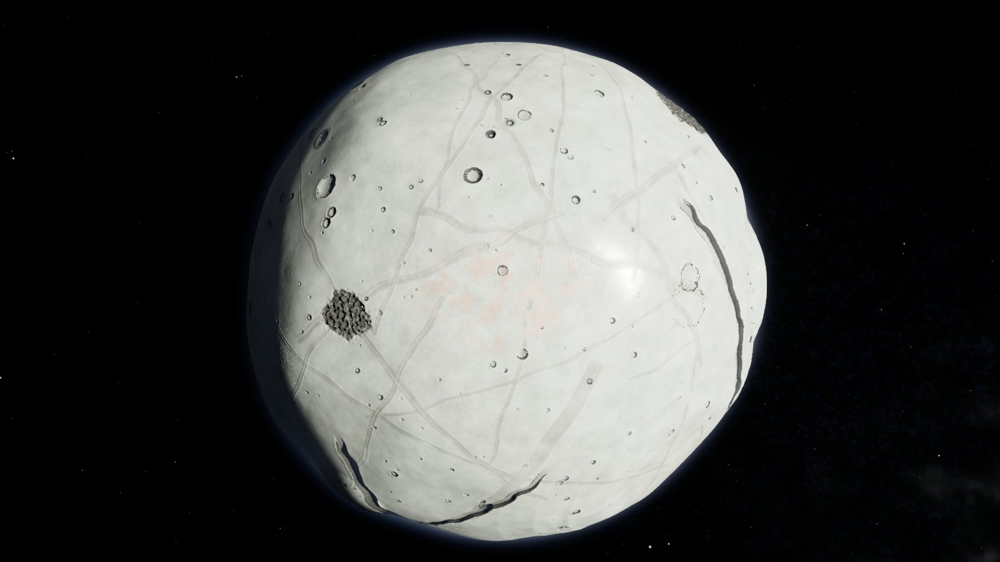
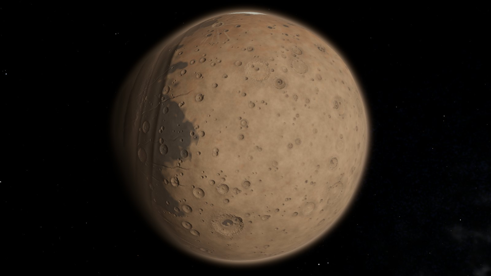
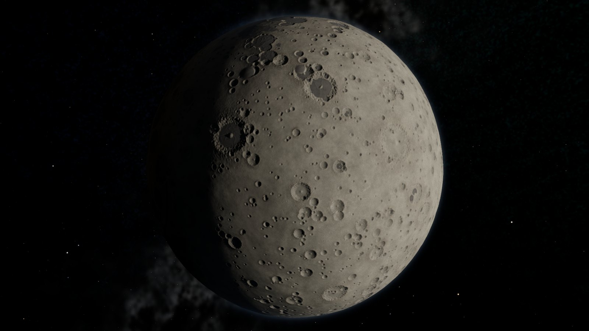
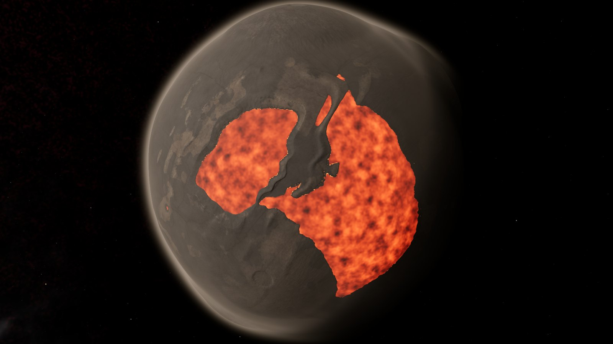

# Planet Forge

Procedural generator and viewer for small rocky, icy and volcanic worlds, from Ceres-sized dwarf planets to Io-like
moons. It is a testbed for a cube-sphere CDLOD planet engine: it uses the same data layout, terrain, splat materials
and look, rendered in the browser with three.js.

**Live demo:** [sigman78.github.io/planet-forge](https://sigman78.github.io/planet-forge/) ·
[planet-forge.ioupg.com](https://planet-forge.ioupg.com)

Needs a WebGL2 browser and a reasonable GPU. A desktop browser works best.

| | | |
|---|---|---|
| [](https://sigman78.github.io/planet-forge/#sulfur/3) | [](https://sigman78.github.io/planet-forge/#wild/1) | [](https://sigman78.github.io/planet-forge/#cryo/2024) |
| Sulfur: `#sulfur/3` | Wild: `#wild/1` | Cryovolcanic: `#cryo/2024` |
| [](https://sigman78.github.io/planet-forge/#rust/78915) | [](https://sigman78.github.io/planet-forge/#grey%20moon/31337) | [](https://sigman78.github.io/planet-forge/#basalt/2) |
| Rust: `#rust/78915` | Grey moon: `#grey%20moon/31337` | Basalt: `#basalt/2` |

Click a picture to open that exact world. Every world has a shareable `#archetype/seed` link.

## What it does

### Generator (`src/gen/`)
Each world starts as a formation history, not as noise:
1. **Bulk:** accretion, core formation and ice fraction set the radius, density, heat and age.
2. **Geology:** geo-zones and units built on that bulk (basins, crater populations, rifts, volcanic provinces,
   cryovolcanic flows, lava lakes, tidal cracks), followed by droplet erosion in direction space (no seams).
3. **Climate, volatiles and materials:** an 8-layer splat map (dust, highland, basalt, sand, rock, gravel, ice, salt).

There are nine archetypes: Rust, Cinder, Grey moon, Ice shell, Old ice, Sulfur, Basalt, Cryovolcanic and Wild.
- **Drama** scales how wild the relief gets.
- **Distortion** turns small bodies into triaxial or lumpy "potatoes". The figure is clamped at ±24.5% of the radius.

The generator runs in a Web Worker pool in the browser. It also runs in Node from the CLI.

### Renderer (`src/render/`, `src/shaders/`)
- HDR pipeline, GGX physically based shading, ACES tone mapping and bloom.
- Displaced, tan-warped cube sphere with no cube-face seams.
- Terrain blends the top 3 splat layers with triplanar mapping, hex-tiling (no visible repeats) and height-based blending.
- **Procedural detail** is one octave spectrum with analytic gradients, in four styles: ridged, billowy, cracked and
  pitted.
  - Landform octaves follow the archetype.
  - Fine octaves follow the local material: dunes on sand, crack networks on ice and salt, lobes on basalt and
    craterlets in regolith.
- **Light:** heightmap ray-marched cast shadows, cavity AO baked on the CPU and planetshine fill from the parent giant,
  so the night side is not pitch black.
- **Atmosphere:** a Rayleigh/Mie post pass plus a low-altitude haze march.
  - The air follows a smoothed map of the body's figure, so lumpy worlds keep their haze on the ground, not in space.
  - Density and haze scale with surface pressure: a faint hint on airless moons, dusty horizons on thin-air worlds.
- **Surfaces:** glowing lava lakes and calderas, plus ice-shell and lava "sea" modes.

### Presentation
- While a world forges, a faceted wireframe hologram blinks and fills in with progress. There is no loading screen.
- Bulk facts decode into the HUD one by one, like scan results.
- The formation history plays as quiet captions along the bottom of the screen.
- Generated worlds are cached in IndexedDB (6 most recent), keyed by the parameters and a hash of the generator source.
  A cached world comes back in about 0.1 s instead of about 3 s.

## Controls

| Input | Action |
|---|---|
| Drag | Orbit |
| Wheel | Zoom (exponential, terrain-aware) |
| Right-drag / Shift-drag | Heading and pitch; the view tilts toward the horizon as you descend |
| `R` | New seed |
| `H` | Hide UI (for screenshots) |
| `T` | Toggle captions |
| `0`–`9` | Debug views: lit, albedo, normals, height, splat, geologic map, temperature, volatiles, flow, cube faces |

- The archetype buttons along the top pick an archetype.
- The side panel exposes every generator parameter (with live regeneration), plus look, landform detail style,
  atmosphere, light, post, cache and debug settings.
- **Export** writes a `.planet` file for engine import tests: a JSON header plus raw face arrays
  (see `src/app/export.ts`).

## Development

```sh
npm install
npm run dev        # http://localhost:5188
npm test           # vitest: cube mapping, generator determinism, seams, splat sums
npm run build      # typecheck + production build (GitHub Pages base /planet-forge/)
npm run gen -- --preset sulfur --seed 3 --res 512 --out out/sulfur   # offline bake + preview PNGs (Node)
npm run deploy     # build + deploy to Cloudflare (planet-forge.ioupg.com) with the cf CLI
```

- **GitHub Pages:** pushing to `master` deploys there through `.github/workflows/pages.yml`.
- **Cloudflare:** an assets-only Worker configured in `cloudflare.config.ts`.

Offline asset tools (Python with [uv](https://docs.astral.sh/uv/), in `tools/`):

```sh
cd tools
uv run python -I fetch_textures.py      # download and pack the CC0 PBR terrain sets -> public/textures
uv run python -I make_sky.py --seed 7   # procedural Milky Way HDR + star catalogue -> public/sky
```

## Layout

| Part | Where | What |
|---|---|---|
| Data contract | `CONTRACT.md`, `src/core/` | Tan-warped cube sphere: 6 faces of N² texels with a 1-texel gutter; height, splat, climate and unit arrays |
| Generator | `src/gen/` | Formation history (`world.ts`), terrain and units (`terrain.ts`), erosion, surface/splat, worker pool, CLI |
| Renderer | `src/render/`, `src/shaders/` | Planet view, terrain/atmosphere/ocean shaders, figure map, hologram, camera controller |
| App | `src/app/`, `src/main.ts` | Presets and look hints, cache, captions, scan readout, export, UI |
| Assets | `public/textures`, `public/sky`, `tools/` | 8 CC0 ambientCG material sets, a synthesized FFT water normal, a procedural HDR sky |

Units: generator heights are metres above the datum. The renderer works in km with the planet at the origin. Texture
tiling is stylised (it would be invisible from orbit at real scale); a real CDLOD engine would switch to true scale near
the ground.

`WORKLOG.md` is the build log, with the decisions and measurements. `docs/notes-*.md` has notes on each part.

## Credits

Terrain textures are CC0 sets from [ambientCG](https://ambientcg.com). See `public/textures/ATTRIBUTION.md`.
Built with [three.js](https://threejs.org), [Vite](https://vite.dev) and [Tweakpane](https://tweakpane.github.io/docs/).

## License

Code: [MIT](LICENSE). Textures: CC0 (ambientCG).
